

  

# Nobody Missing

## A shelter kit with AI that keeps working when the network doesn't.

**Nobody Missing** is a hybrid-AI kit for disaster shelters. It helps the staff and volunteers at the door count every evacuee, care for the vulnerable ones, and get every message understood, **with no signal at all**. Gemini Nano does the private, everyday work on the phone or laptop. When signal returns, Gemini in the cloud joins in for what truly needs it: checking medicines, finding which pharmacy is open through **Grounding with Google Maps**, and finding families across shelters. **Firebase AI Logic** carries every call, and Kit, our lantern-cat router, decides where each task runs, and shows you why.

  
  
  
  
  

## Inspiration

**Sumatra, 2025.** The floods displaced 975,079 people (BNPB). Parts of Aceh went **four days without a single bar of signal**. And when the lists were counted, BPS found that 179,000 evacuee records were really 60,426 households: the same people written down again and again, by hand, at different doors.

In a disaster, the people we lose first are not always lost in the water. They are lost in the shelter: the deaf grandmother who never heard the announcement, the grandfather whose insulin ran out, the daughter who can't find her father because his name was spelled three different ways.

Every AI app we could imagine for that shelter failed in one of two ways. A cloud app is dead the moment the tower goes down. A device-only app can't check medicines against a big model, can't tell you which pharmacy is open *right now*, and can't search the shelter down the road. Firebase AI Logic's hybrid inference was the first time we could build the honest answer: **both, decided per task.**

## What it does

  

**Who it's for:** the staff and volunteers who run an evacuation shelter, on one phone or laptop. **Evacuees don't need a phone:** they get information from the hall's Big Screen, printouts, staff, and public pages on the shelter's own Wi-Fi.

| Nobody Missing does | How | Where the AI runs |
| --- | --- | --- |
| **1 · Warning in, no signal** | An official flood warning becomes plain words and the nearest higher place to go: walk 794 m, 5 m higher. | 🏮 Phone, in 3.8 s, offline (`PREFER_ON_DEVICE`) |
| **2 · Count everyone** | A photo of a handwritten list becomes a roster with vulnerable flags. Check-in at the door says “Maybe already here” before a duplicate is born. | 🏮 Phone only: names, health, faces (`ONLY_ON_DEVICE`) |
| **3 · Tell everyone** | An announcement becomes big picture cards for the Big Screen and print, plus a list of who must be told in person: deaf, hard of hearing, living alone, 75+. | 🏮 Phone: **measured** 83% vs the cloud's 67% |
| **4 · Care for the vulnerable** | A medicine-label photo becomes a care card. A Medicine Round with can't-miss alerts (insulin, epilepsy, anticoagulants). | 🏮 Phone only: medical data |
| **5 · Wait safely** | Work that needs the internet goes into the outbox. Signal Scout confirms a real connection twice, sounds an alert, and sends the most urgent first. | ⏳ Outbox → ☁️ Cloud |
| **6 · Check medicines** | When signal returns, the cloud checks interactions and substitutes for Pak Hasan's insulin. | ☁️ Cloud, **drug names only** (`ONLY_IN_CLOUD`) |
| **7 · Find it open** | Which pharmacy, dialysis centre or health post is open now? | ☁️ Cloud + **Grounding with Google Maps**, location rounded to ~1 km |
| **8 · Find family** | “My father Hasan Basry, about 80.” Her words are understood on her phone; only the name goes out for other spellings. Pak Hasan Basri: safe. | 🏮 Phone + ☁️ cloud, **the name only** |
| **9 · Show the proof** | *Where Kit ran*: every answer with where it ran, why, how long, and exactly what left the shelter. | Logged from the SDK's real `inferenceSource` |
| **10 · Private mode** | One switch blocks every cloud task for the whole shelter. On-device work keeps going. | 🏮 Phone only |

## Product walkthrough

<table>
  <tr>
    <td width="50%"> <strong>1 · Warning in. No signal.</strong> Gemini Nano turns the official warning into plain words and a place to go, offline.</td>
    <td width="50%"> <strong>2 · Names. Health. Faces.</strong> Even with signal, a paper list is read on the phone and never leaves it.</td>
  </tr>
  <tr>
    <td width="50%">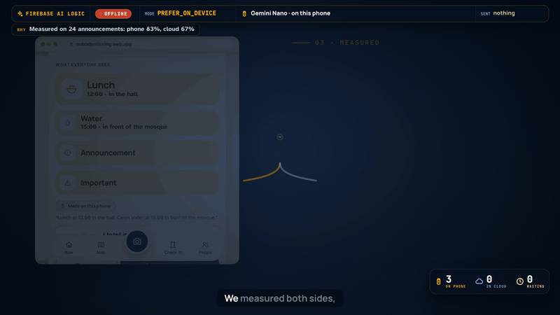 <strong>3 · Measured → the phone wins.</strong> On our 24-announcement eval, Nano beat the cloud, so cards are made on the phone.</td>
    <td width="50%"> <strong>4 · One photo, read on the phone.</strong> The insulin label becomes the care card. Medical data stays local.</td>
  </tr>
  <tr>
    <td width="50%"> <strong>5 · It waits.</strong> The medicine check needs the cloud, so it waits in the outbox (real Android airplane mode).</td>
    <td width="50%"> <strong>6 · Signal is back.</strong> The outbox sends, most urgent first. The cloud sees only the drug names.</td>
  </tr>
  <tr>
    <td width="50%">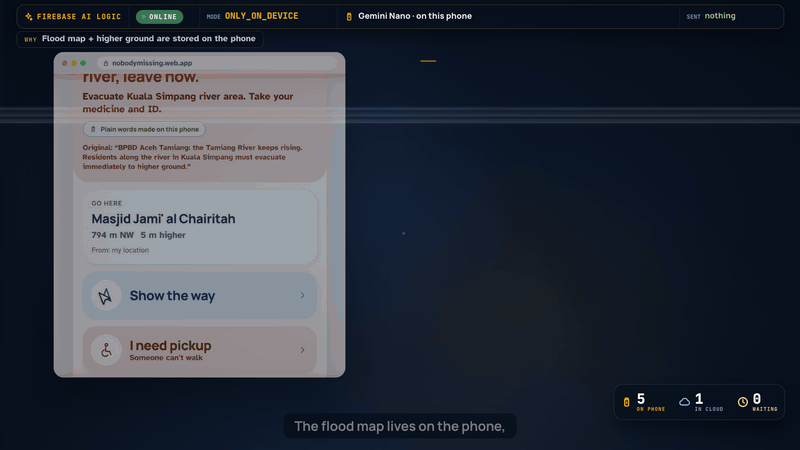 <strong>7 · Higher ground, offline.</strong> Real flood data (Global HAND 30 m + OpenStreetMap) lives on the phone.</td>
    <td width="50%">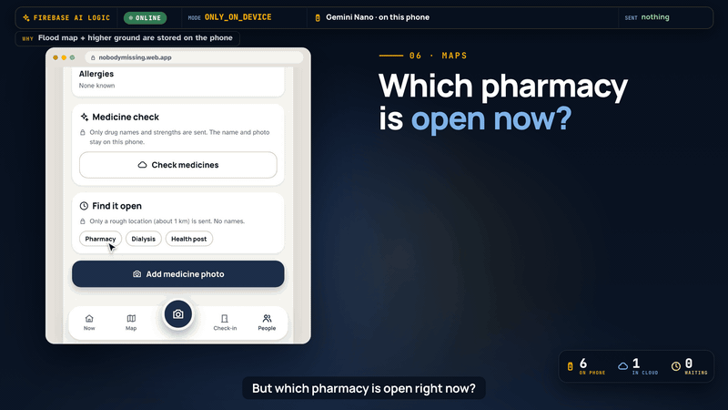 <strong>8 · Which pharmacy is open now?</strong> Live places go to Gemini with Grounding with Google Maps; only a rough location is sent.</td>
  </tr>
  <tr>
    <td width="50%"> <strong>9 · Spelled wrong. Found anyway.</strong> Her words stay on her phone; only the name goes to the cloud.</td>
    <td width="50%">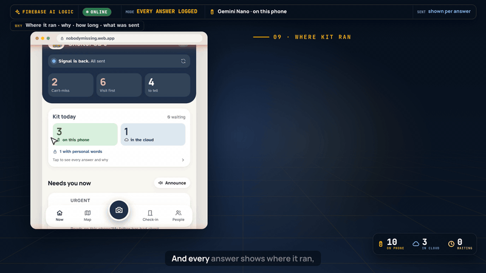 <strong>10 · Where. Why. What left.</strong> Every answer shows where it ran and exactly what left the shelter.</td>
  </tr>
</table>

| Warning in plain words | Show the way, offline | “I need help”, on the phone | Check-in: maybe already here |
| --- | --- | --- | --- |
| 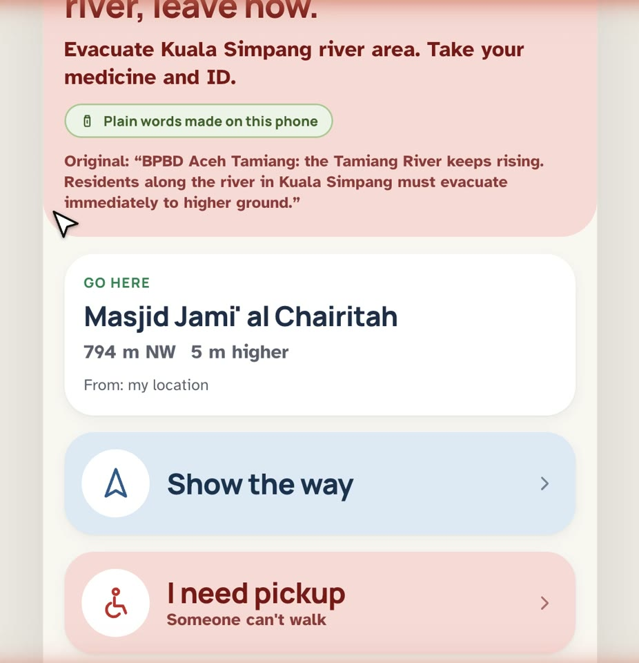 | 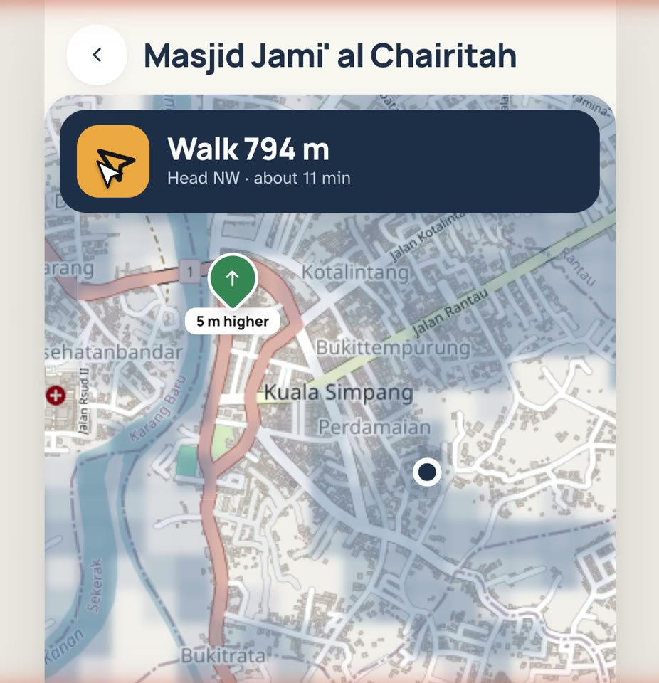 | 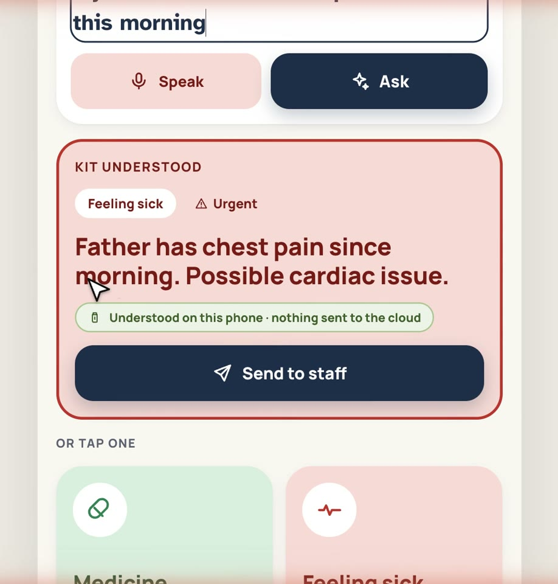 | 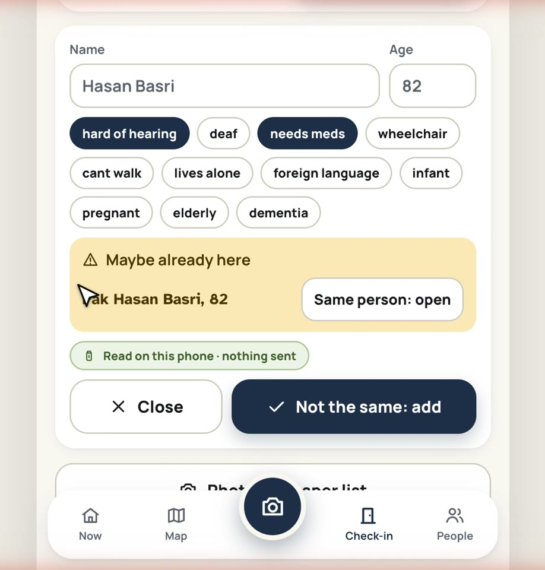 |

| Medicine check waits | Medicine check in the cloud | Family found | Where Kit ran |
| --- | --- | --- | --- |
| 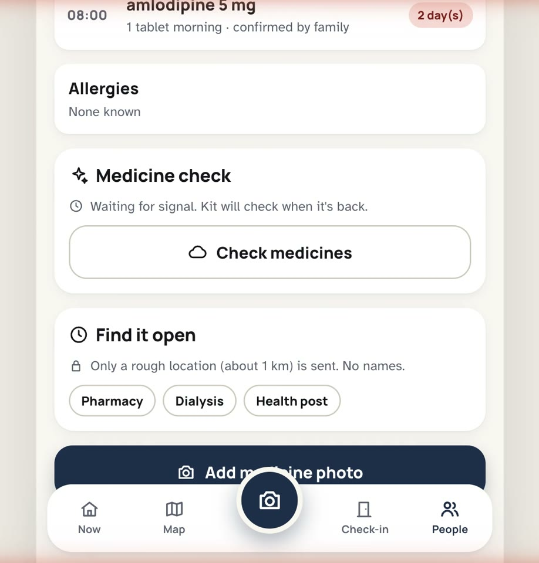 | 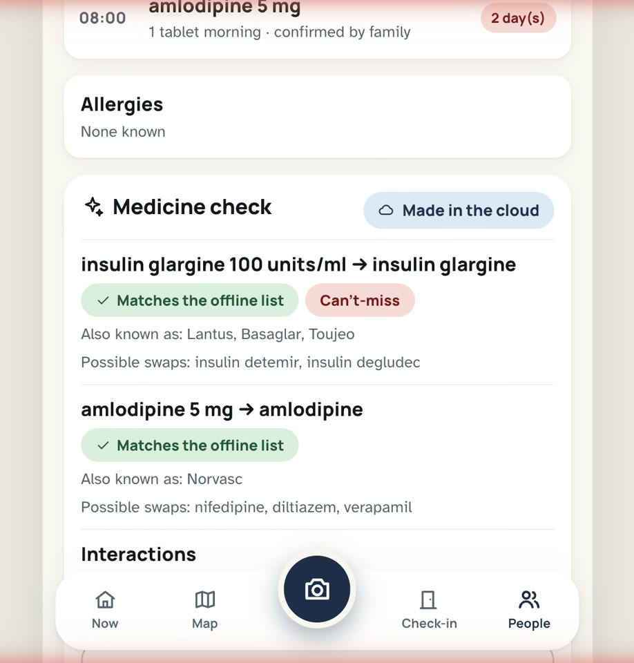 |  |  |

| Android: no signal | Android: signal is back | Android: Where Kit ran | Measured, in the app |
| --- | --- | --- | --- |
|  |  | 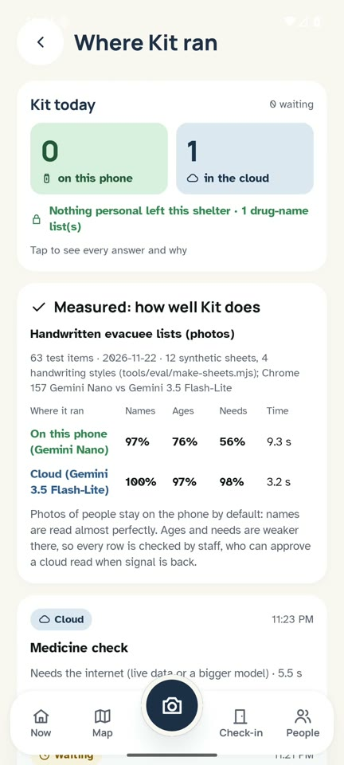 | 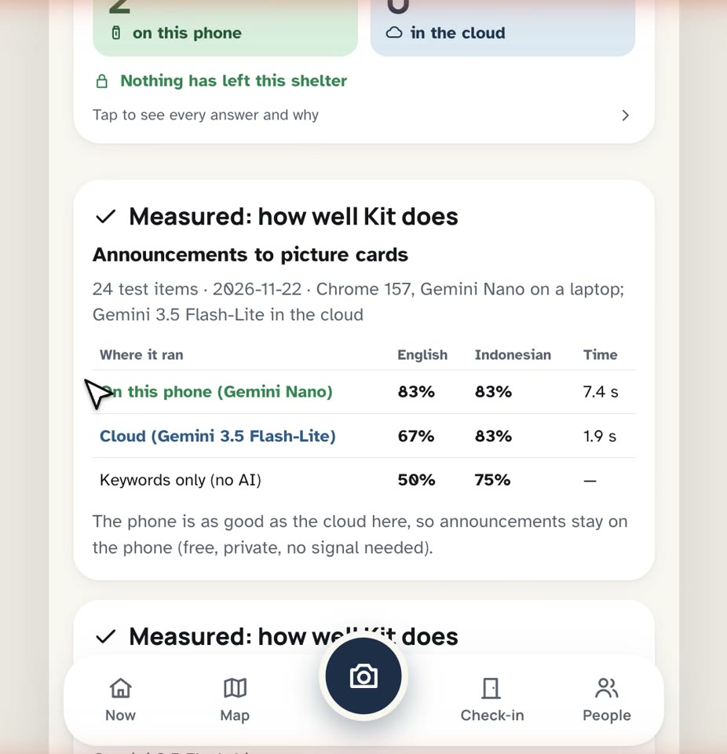 |

## How we used Firebase AI Logic

  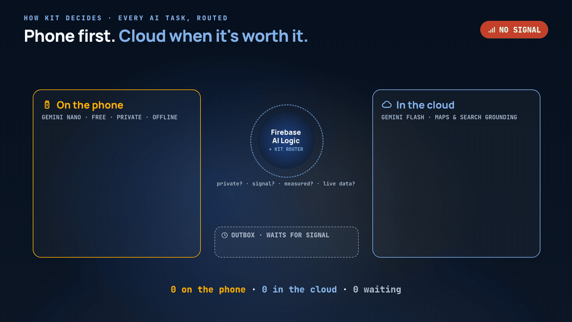

**Every AI call in both apps goes through Firebase AI Logic**: `getGenerativeModel(ai, { mode, inCloudParams, onDeviceParams })` on web (`firebase/ai` 13.4) and `firebase-ai` 18.2 + `firebase-ai-ondevice` on Android, with **App Check enforced**. We don't use one global mode. We built **Kit, a router on top of the SDK** that picks the mode per task, for a reason a shelter can understand:

| Reason | Inference mode | Tasks |
| --- | --- | --- |
| 🔒 **Private**: names, health, faces, a family's words | `ONLY_ON_DEVICE` + our privacy guard | paper-list roster, medicine label, check-in, help request, pickup, family query, field report |
| 📶 **No signal** during an evacuation | `PREFER_ON_DEVICE` | warning → plain words, Ask Kit, translation |
| 📊 **Measured**: the device is as good or better | `PREFER_ON_DEVICE` | announcements (Nano 83% vs cloud 67% EN; 83% vs 83% ID) |
| 🌐 **Needs live data or a bigger model** | `ONLY_IN_CLOUD`, queued in the outbox when offline | medicine check (drug names only), **Grounding with Google Maps** (open places, ~1 km), **Grounding with Google Search** (latest official warning), name spellings (name only), supply requests (counts only) |
| 🛑 **The shelter says no** | Private mode | every cloud task blocked |

What we added on top of the SDK, because a shelter needs guarantees, not just fallback:

1. **A policy table in Remote Config** (`routerPolicy`): 17 tasks, each with its sensitivity, cloud model and measured accuracy. Change the routing without shipping an app.
2. **A privacy guard.** It checks the on-device model *before* calling, and **throws away any cloud answer** to an on-device-only request (a guard against firebase-js-sdk#10635).
3. **Honest timeouts.** A slow phone may fall back to the cloud for public tasks. A private task never falls back silently: staff are asked.
4. **Schema validation** of every answer, on-device prompts with `responseConstraint`, cloud calls with `responseJsonSchema`.
5. **The outbox and Signal Scout.** Cloud work survives no signal, then sends in priority order once a real request succeeds twice.
6. **Where Kit ran.** Each answer is logged with the SDK's real `inferenceSource`, the reason, the time and what left the shelter. The *Kit today* card counts it: on the phone · in the cloud · waiting.

### Measured, not claimed

  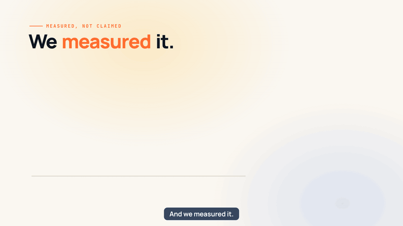

| Eval | 🏮 Gemini Nano (on device) | ☁️ Gemini 3.5 Flash-Lite (cloud) | 🔤 Keywords (no AI) | Decision |
| --- | --- | --- | --- | --- |
| **24 announcements → cards**, English | **83%** · 7.4 s | 67% · 1.9 s | 50% | Phone |
| Same, Indonesian | **83%** | 83% | 75% | Phone (free, private, offline) |
| **63 people on 12 handwritten sheets**: names | **97%** · 9.3 s | 100% · 3.2 s | — | Phone by default |
| Same: ages / needs | 76% / 56% | 97% / 98% | — | Staff check every row; cloud read only if staff approve |

These numbers live in `shared/eval/results.json` and are shown inside both apps, so a shelter coordinator sees the same evidence we used.

## How we built it

  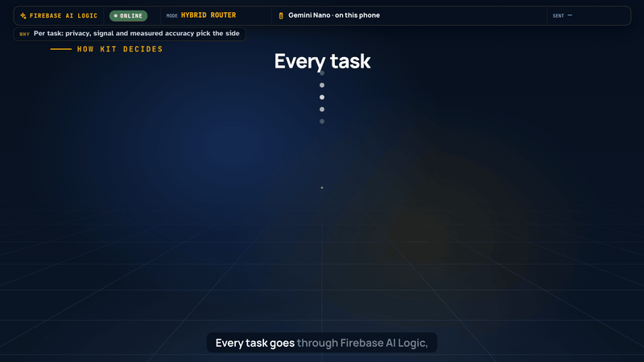

| Technology | Role in Nobody Missing |
| --- | --- |
| **Firebase AI Logic** | All inference, hybrid: Gemini Nano on device; Gemini 3.5 Flash-Lite and 3.8 Flash in the cloud on the Gemini Developer API (no-cost tier), with Maps and Search grounding |
| **Firebase App Check** | Enforced. reCAPTCHA Enterprise (web), Play Integrity (Android), debug tokens for judges |
| **Firebase Remote Config** | Router policy, measured accuracy, thresholds, prompt pack, with bundled defaults for offline |
| **Cloud Firestore** + **Anonymous Auth** | Cross-shelter family index, supply requests and alerts (counts only), offline cache, rules unit-tested in the emulator |
| **Web**: React 19 · Vite 8 · TypeScript | Staff app, Big Screen, evacuee public pages, installable and offline (service worker) |
| **Android**: Kotlin · Jetpack Compose | Same domain, router and features; state saved on the phone; system print |
| **Shelter Wi-Fi hub** (Node, no deps, no AI) | Serves the app on a laptop hotspot, so evacuee phones get news with no internet |
| **Region pack**: Global HAND 30 m + OpenStreetMap | Real flood-height data for Kuala Simpang, Aceh, on the phone, for “higher ground” |

**One domain, two platforms.** `shared/` holds the rules, JSON schemas, prompt pack, EN/ID strings and **golden fixtures** that both the TypeScript and the Kotlin domains must pass. Ports and adapters keep AI Logic, Firestore and Remote Config behind interfaces, so the same features run in production, the emulator, tests and demo mode.

## Challenges we ran into

- **`ONLY_ON_DEVICE` isn't a promise on its own.** A known SDK issue can send an on-device request to the cloud. We feature-detect the model first and discard any cloud answer to a private request.
- **Small models talk around their JSON.** Every answer is schema-validated; prose around JSON is stripped; failures become “Needs review”, never silent data.
- **Nano is slow on long photos.** Our first roster prompt took ~2× longer and dropped ages. A shorter on-device prompt fixed both. We moved the device timeout from 8 s to 15 s, measured, not guessed.
- **Indonesian on device is officially unsupported.** So we measured it instead of assuming: 83%, the same as the cloud.
- **Free-tier reality.** `gemini-3.8-flash` was often overloaded (500) or out of quota (429), so the router falls back to Flash-Lite. The grounding quota ran out while we recorded the film.
- **Offline is a state machine, not a banner.** The outbox, Signal Scout (two real successes before “signal is back”), priority sync and the QR courier took more care than any prompt.

## Accomplishments that we're proud of

  

- **Seventeen AI tasks, each with its own inference mode and a reason**, not one global switch.
- **Hybrid you can see.** Badges on every answer, *Where Kit ran*, and the *Kit today* counter make the routing visible to staff and judges.
- **Measured routing.** The device won where we expected it to lose; the data moved announcements back to the phone.
- **Two platforms, one domain:** web and Android pass the same golden fixtures. Web has unit, Playwright end-to-end (including axe accessibility checks) and Firestore rules tests; Android has JUnit over the same fixtures.
- **Real offline:** the Android recording uses real airplane mode; the flood map is real data stored on the phone.
- A 3-minute film built from the real recordings, with kinetic typography, an original score and a narrated walkthrough.

## What we learned

The interesting part of hybrid AI isn't the fallback. It's the **reason**: why this task, on this data, should run here. Once every task had a reason a shelter worker could read (“private”, “no signal”, “measured”, “needs the internet”), the app became trustworthy, and the cloud stopped being scary. The second lesson: **measure before you route.** Our assumption that the cloud always wins was wrong for the task that matters most in a hall full of people.

## What's next

- A field test with a BPBD shelter team in Aceh, with real (consented) paper lists to replace our synthetic eval set.
- Gemini Nano on a real Pixel or Galaxy device for the Android on-device path, beyond the emulator.
- A shelter-to-shelter mesh: QR courier today, local Wi-Fi sync between nearby hubs next.
- More languages for the picture cards and the Big Screen, starting with Acehnese and Javanese.

## Honest limits

- **Not medical advice.** No dose decisions, no pill identification by look, no diagnosis. Drug names are matched by deterministic code and confirmed by a person.
- **Hazard maps are scenarios.** The app says “higher”, never “safe”.
- **Android on-device** is wired through `firebase-ai-ondevice`; our Android recordings ran in the emulator, which has no Gemini Nano, so Android shows keyword rules and the cloud path.
- **Grounding** (Maps and Search) is implemented end to end, but the free-tier quota was exhausted when we recorded, so the film shows the request and what is sent, not a live list of places.
- All people, shelters and the drug list in the demo are **synthetic**.

## Built during #BuildHybridAI

Nobody Missing is a new project: the first commit is from November 21, 2026, inside the submission period. Everything here (both apps, the router, the evals, the hub and the film) was built for this hackathon.

## Try it

- **Source:** [github.com/azharizz/nobodymissing](https://github.com/azharizz/nobodymissing) (Apache-2.0)
- **Run the web app (demo mode, no keys needed):** `cd web && npm ci && npm run dev`, open the printed URL, then Settings → “Load demo shelter”. Views: `#/staff/now`, `#/big`, `#/public/news`.
- **On-device:** Chrome desktop ≥148 with Gemini Nano (`chrome://flags` → “Gemma 4 for Built-in AI”). Without it the cloud fallback runs, and the badge says so.
- **Try offline:** DevTools → Network → Offline, then announce, read a photo, or ask Kit. Tap the signal button on staff Now to watch the outbox send.
- **Android:** `cd android && ./gradlew :app:assembleDebug` (JDK 21).
- **Full setup with your own Firebase project:** see the [README](https://github.com/azharizz/nobodymissing#-run-it).
