

  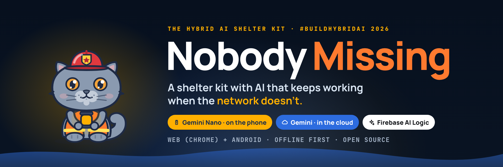

# Nobody Missing

## A shelter kit with AI that keeps working when the network doesn't.

  
  
  
  
  

> **In 30 seconds.**
> **Who:** the staff and volunteers running an evacuation shelter, and the evacuees disasters leave behind: deaf, hard-of-hearing and elderly people, who often have no phone.
> **Problem:** after a flood, signal is gone for days, lists are handwritten and duplicated, and spoken announcements never reach the people who can't hear them.
> **How Firebase AI Logic makes it work:** Gemini Nano does the shelter's private, everyday work on the staff phone or laptop with no signal. Gemini in the cloud, with Grounding with Google Maps and Search, joins in when signal returns, for the few jobs that need live data or a bigger model. A router on top of the SDK picks one of **all four inference modes per task**, for a reason staff can read, and the app shows exactly what left the shelter.

## Inspiration

**The people we lose first are not always lost in the water. They are lost in the shelter.**

| Evidence | What it tells us |
| --- | --- |
| **Sumatra floods, 2025:** 975,079 people displaced (BNPB, Dec 7). In Aceh Utara, evacuees went **4 days with no signal on any operator**. | The cloud is not there when the shelter needs it most. |
| BPS found that **179,000 evacuee records were really 60,426 households**. | Paper lists, written at different doors, multiply the same people. |
| **Noto earthquake, 2024:** officials **photographed handwritten lists and emailed them**; staff checked home-nursing patients **one phone call at a time**. Disaster-related deaths afterwards (397) **exceeded direct deaths (228)**. | The deadly gap comes *after* the event, inside the shelter. |
| **Kobe, 1995:** the deaf death rate was **over 4× that of hearing people** (Kobe Deaf Association). **Tohoku, 2011:** 56.1% of deaths were people aged 65+. | Spoken announcements and sirens don't reach everyone. |
| In Japan only **53% of people in their 70s use a smartphone** (MIC 2025). | The most vulnerable evacuee can't be asked to install an app. |
| Warnings *before* a disaster already work (cell broadcast; BMKG warns in 2–3 minutes). **Google Person Finder shut down in 2019.** | We don't build another warning app. We build for the days after. |

So we built for one shelter, one night, one family. **Pak Hasan, 82**, is hard of hearing, can't walk far, and needs insulin every night. **Ibu Rina, 45**, is deaf. Pak Hasan's daughter is two shelters away, searching for a name that was written down three different ways. Every one of them is synthetic; every problem is real.

## What it does

  

One staff phone or laptop runs the shelter. **Evacuees never need a phone:** they get information from the hall's Big Screen, printouts, staff, and public pages served over the shelter's own Wi-Fi by a laptop hotspot.

| Nobody Missing does | For whom | Where the AI runs, and why |
| --- | --- | --- |
| **1 · Warning in, no signal.** An official flood warning becomes plain words and the nearest *higher* place: walk 794 m, 5 m higher, on a real offline flood map. | Evacuees | 🏮 Phone, 3.8 s, offline: **no signal** during an evacuation |
| **2 · Count everyone.** A photo of a handwritten list becomes a roster with needs; check-in at the door says “Maybe already here” before a duplicate is born. | Staff | 🏮 Phone only: **names, health, faces** |
| **3 · Tell everyone.** An announcement becomes big picture cards for the Big Screen and print, plus a list of who must be told **in person**: deaf, hard of hearing, living alone, 75+. | Pak Hasan, Ibu Rina | 🏮 Phone: **measured**, Nano 83% vs cloud 67% |
| **4 · Care for the vulnerable.** A medicine-label photo becomes a care card; a Medicine Round with can't-miss alerts (insulin, epilepsy, anticoagulants). | Pak Hasan | 🏮 Phone only: **medical data** |
| **5 · Wait safely.** Work that needs the internet waits in the outbox. Signal Scout confirms a real connection twice, sounds an alert, and sends the most urgent first. | Staff | ⏳ Outbox → ☁️ cloud |
| **6 · Check medicines.** Interactions and substitutes for the insulin, once signal returns. | Staff | ☁️ Cloud, **drug names only** |
| **7 · Find it open.** Which pharmacy, dialysis centre or health post is open *now*? | Staff | ☁️ Cloud + **Grounding with Google Maps**, location rounded to ~1 km |
| **8 · Find family.** “My father Hasan Basry, about 80.” Her words are understood on her phone; only the name goes out for other spellings. | Pak Hasan's daughter | 🏮 Phone + ☁️ cloud, **the name only** |
| **9 · Show the proof.** *Where Kit ran* and the *Kit today* counter: every answer with where it ran, why, how long, and exactly what left the shelter. | Staff, judges | From the SDK's real `inferenceSource` |
| **10 · Private mode.** One switch blocks every cloud task for the whole shelter; on-device work keeps going. | The shelter | 🏮 Phone only |

## Product walkthrough

<table>
  <tr>
    <td width="50%">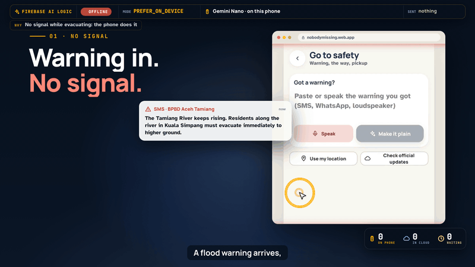 <strong>1 · Warning in. No signal.</strong> Gemini Nano turns the official warning into plain words and a place to go, offline.</td>
    <td width="50%">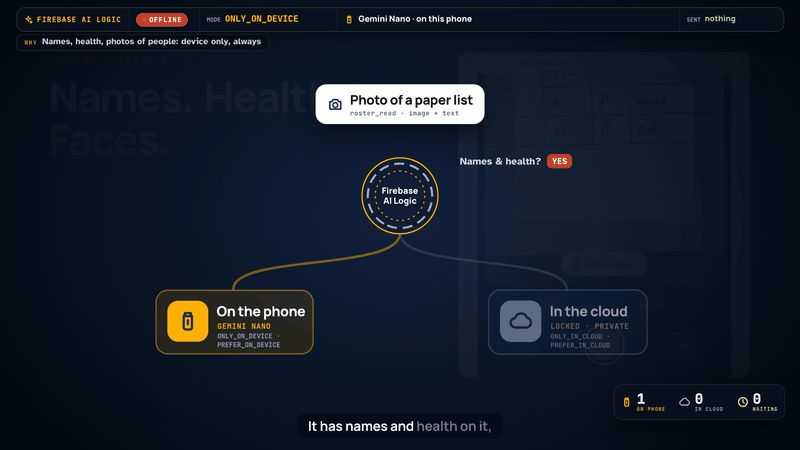 <strong>2 · Names. Health. Faces.</strong> Even with signal, a paper list is read on the phone and never leaves it.</td>
  </tr>
  <tr>
    <td width="50%"> <strong>3 · Measured → the phone wins.</strong> Cards are made on the phone, and Kit flags who must be told in person.</td>
    <td width="50%">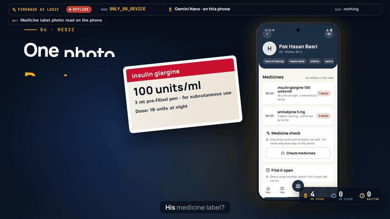 <strong>4 · One photo, read on the phone.</strong> The insulin label becomes the care card. Medical data stays local.</td>
  </tr>
  <tr>
    <td width="50%">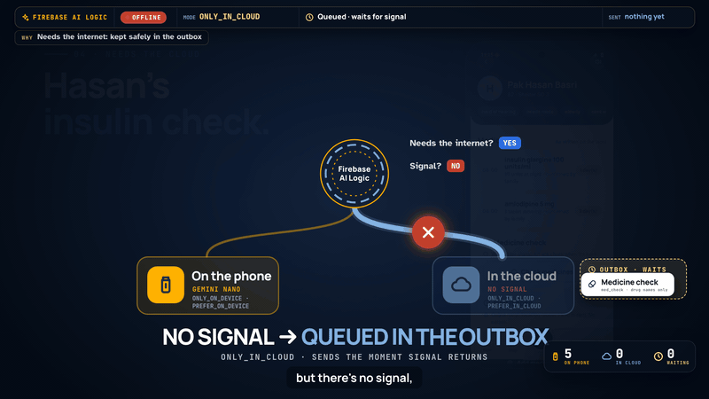 <strong>5 · It waits.</strong> The medicine check needs the cloud, so it waits in the outbox (real Android airplane mode).</td>
    <td width="50%">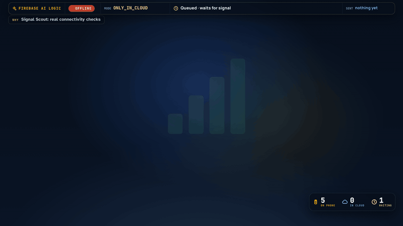 <strong>6 · Signal is back.</strong> The outbox sends, most urgent first. The cloud sees only the drug names.</td>
  </tr>
  <tr>
    <td width="50%"> <strong>7 · Higher ground, offline.</strong> Real flood-height data (Global HAND 30 m + OpenStreetMap) lives on the phone.</td>
    <td width="50%"> <strong>8 · Which pharmacy is open now?</strong> Live places go to Gemini with Grounding with Google Maps; only a rough location is sent.</td>
  </tr>
  <tr>
    <td width="50%">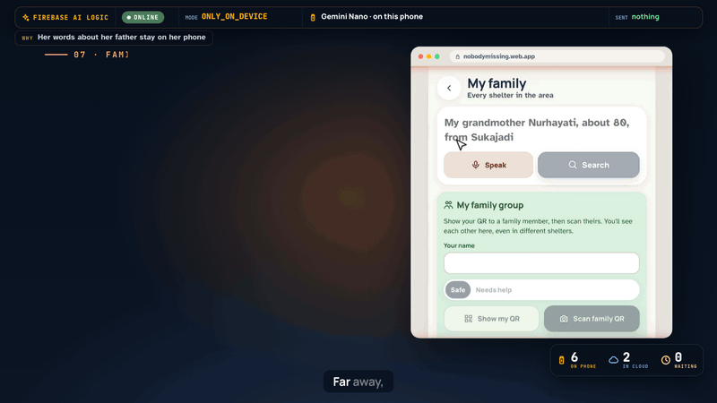 <strong>9 · Spelled wrong. Found anyway.</strong> Her words stay on her phone; only the name goes to the cloud.</td>
    <td width="50%"> <strong>10 · Where. Why. What left.</strong> Every answer shows where it ran and exactly what left the shelter.</td>
  </tr>
</table>

| Warning in plain words | Show the way, offline | Announcement → picture cards | “I need help”, on the phone |
| --- | --- | --- | --- |
|  |  |  |  |

| Check-in: maybe already here | Medicine check waits | Medicine check in the cloud | Family found |
| --- | --- | --- | --- |
|  |  |  | 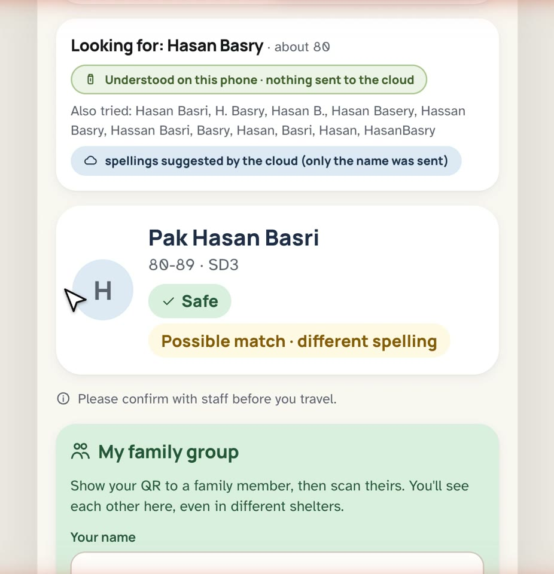 |

| Android: no signal | Android: signal is back | Android: Where Kit ran | Web: Where Kit ran |
| --- | --- | --- | --- |
| 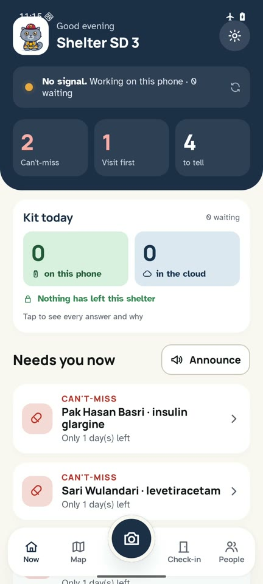 | 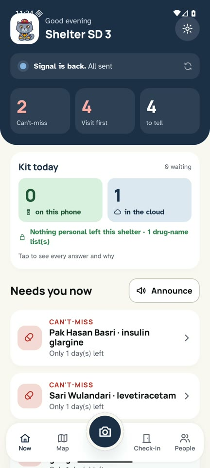 |  | 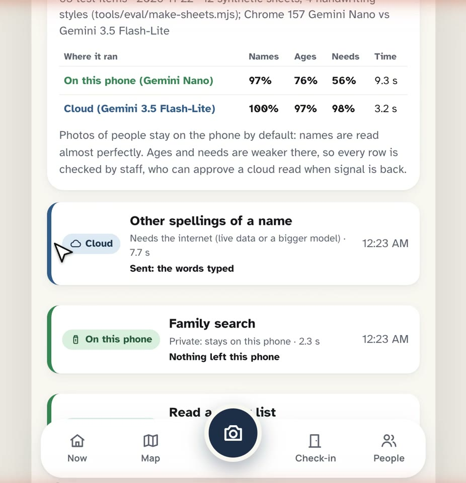 |

## How we used Firebase AI Logic

  

**Every AI call in both apps goes through Firebase AI Logic**: `getGenerativeModel(ai, { mode, inCloudParams, onDeviceParams })` on web (`firebase/ai` 13.4) and `firebase-ai` 18.2 + `firebase-ai-ondevice` on Android, with **App Check enforced**. The SDK switches on *availability*. Kit, our router, adds the *reason*, per task, from a policy table in Remote Config.

### The reason comes from the shelter, not from the technology

| Shelter reason | Hybrid pattern | Inference mode | Tasks |
| --- | --- | --- | --- |
| 🔒 **Private**: names, health, faces, a family's own words | Keep sensitive data on the device | `ONLY_ON_DEVICE` + our privacy guard | paper-list roster, medicine label, check-in, help request, pickup, family query, field report |
| 📶 **No signal** for days | Offline capture, online enrichment | `PREFER_ON_DEVICE`, cloud work queued in the outbox | warning → plain words, Ask Kit, translation; the outbox holds cloud jobs |
| 📊 **Measured**: the device is as good | Triage on the device, escalate only when it's worth it | `PREFER_ON_DEVICE` | announcements (Nano 83% vs cloud 67%) |
| 📉 **Measured**: the device is weaker by more than the bar | Escalate | `PREFER_IN_CLOUD` online; offline the device makes a **draft for review** and a cloud re-check is queued | any non-private task whose numbers fall below `accuracyBarPoints` (3) |
| 🌐 **Needs live data or a bigger model** | Local understanding, cloud reasoning on the minimum | `ONLY_IN_CLOUD` | medicine check (drug names), **Grounding with Google Maps** (open places, ~1 km), **Grounding with Google Search** (latest official warning), name spellings, supply counts |
| 🛑 **The shelter says no** | Consent | Private mode | every cloud task blocked |

### Kit's decision, exactly as coded (`web/src/domain/router.ts`, mirrored in Kotlin)

| Task type | Private mode on | Online | Offline |
| --- | --- | --- | --- |
| **Cloud-only** (live data, bigger model) | 🛑 block | ☁️ `ONLY_IN_CLOUD` | ⏳ queue in the outbox |
| **Sensitive**, model on the device | 🏮 `ONLY_ON_DEVICE` | 🏮 `ONLY_ON_DEVICE` | 🏮 `ONLY_ON_DEVICE` |
| **Sensitive**, no model on the device | 🛑 block | 🙋 ask staff (cloud only after approval) | 🙋 ask staff, then queue |
| **Public**, device measurably weaker | 🏮 draft (block if no model) | ☁️ `PREFER_IN_CLOUD` | 🏮 draft + “needs review”, cloud re-check queued |
| **Public**, device as good (model ready) | 🏮 `ONLY_ON_DEVICE` | 🏮 `PREFER_ON_DEVICE` | 🏮 `PREFER_ON_DEVICE` |

Six outcomes (device, device draft, cloud, ask staff, queue, block) and **all four SDK inference modes**, each used where the shelter's situation calls for it.

### What we built on top of the SDK

1. **A policy table in Remote Config** (`routerPolicy`): 17 tasks, each with sensitivity, cloud model, grounding and **measured accuracy**. Change the routing without shipping an app; bundled defaults keep it working offline.
2. **A privacy guard.** It checks that the on-device model is ready *before* calling, and **throws away any cloud answer** to an on-device-only request (we hit firebase-js-sdk#10635, where `ONLY_ON_DEVICE` could use the cloud).
3. **Honest timeouts.** A slow device may fall back to the cloud for public tasks; a private task never falls back silently. Staff are asked.
4. **Structured output both ways:** `responseConstraint` on the device, `responseJsonSchema` in the cloud, and schema validation of every answer before it touches the roster.
5. **The outbox and Signal Scout.** Cloud jobs survive no signal; a real request must succeed twice before Kit says “signal is back”; then jobs send by priority. A QR courier can carry the queue to a phone that has signal.
6. **Minimum data out:** drug names and strengths (never names or beds); location rounded to 2 decimals (~1 km); the name only for spellings; counts by generic name for supplies.
7. **Where Kit ran.** Each answer is logged with the SDK's real `inferenceSource`, the reason, the time and what left the shelter; the *Kit today* card counts **on the phone · in the cloud · waiting**.
8. **Pre-download.** Staff can download the on-device model ahead of time from Settings → *Prepare on-device AI*.

### Measured, not claimed

  

| Eval | 🏮 Gemini Nano (on device) | ☁️ Gemini 3.5 Flash-Lite (cloud) | 🔤 Keywords (no AI) | Routing decision |
| --- | --- | --- | --- | --- |
| **24 announcements → cards**, English | **83%** · 7.4 s | 67% · 1.9 s | 50% | Phone |
| Same, Indonesian (officially unsupported on device) | **83%** | 83% | 75% | Phone: free, private, offline |
| **63 people on 12 handwritten sheets**: names | **97%** · 9.3 s | 100% · 3.2 s | — | Phone by default |
| Same: ages / needs | 76% / 56% | 97% / 98% | — | Staff confirm every row; a cloud read only if staff approve |

The numbers live in `shared/eval/results.json`, are shown inside both apps, and feed the router's policy table. We expected the cloud to win announcements. It didn't, so the data moved them back to the phone.

## How we built it

  

| Technology | Role in Nobody Missing |
| --- | --- |
| **Firebase AI Logic** | All inference, hybrid: Gemini Nano on device; Gemini 3.5 Flash-Lite and 3.8 Flash in the cloud on the Gemini Developer API (no-cost tier); Grounding with Google Maps and Google Search |
| **Firebase App Check** | Enforced. reCAPTCHA Enterprise (web), Play Integrity (Android), debug tokens for judges |
| **Firebase Remote Config** | Router policy, measured accuracy, accuracy bar, thresholds, prompt pack, with bundled defaults for offline |
| **Cloud Firestore** + **Anonymous Auth** | Cross-shelter family index, supply requests and alerts (counts only), offline cache; security rules unit-tested in the emulator |
| **Web**: React 19 · Vite 8 · TypeScript | Staff app, Big Screen, evacuee pages; installable and cached for offline |
| **Android**: Kotlin · Jetpack Compose | Same domain, router and features; state saved on the phone; system print |
| **Shelter Wi-Fi hub** (Node, no dependencies, no AI) | Serves the app over a laptop hotspot so evacuee phones get news with no internet |
| **Region pack**: Global HAND 30 m + OpenStreetMap | Real flood-height data for Kuala Simpang, Aceh, stored on the phone |

**One domain, two platforms.** `shared/` holds the rules, JSON schemas, prompt pack, EN/ID strings and **golden fixtures** that both the TypeScript and the Kotlin domains must pass, so web and Android provably make the same routing decisions.

| Test suite | Count | What it proves |
| --- | --- | --- |
| Web unit (Vitest) | **175** | Shared fixtures, router, privacy guard, features |
| Web end-to-end (Playwright) | **14** | Offline → signal flows, medicine check + Find it open waiting for signal, family search, first hours, **axe accessibility (WCAG 2 A/AA)** |
| Firestore rules (emulator) | **10** | Non-members can't read the roster; members can't promote devices; alerts carry counts only, never names; supply requests reject names |
| Android (JUnit) | **44** | The same shared fixtures, router, features, Remote Config override, the log never claims the device did cloud work |

## Design: built for the people who can't use the app

- **No phone needed for evacuees.** Big Screen picture cards in the hall, black-and-white printouts (roster, medicine round with tick boxes, tell-in-person list), and public pages on the shelter's Wi-Fi.
- **Deaf-first announcements.** Every notice becomes big pictures with time and place, and a reach list of who must be told in person.
- **Readable under stress.** Atkinson Hyperlegible type, large touch targets, few pages, no login, English and Indonesian. Automated axe checks find no serious or critical issues on the main screens.
- **Hybrid you can see.** A badge on every answer (🏮 Device / ☁️ Cloud / ⚠️ Needs review / 🔤 Keywords), the original photo or text beside every AI result, and Kit, a calm lantern-cat, whose mood shows on the phone, in the cloud, or waiting.

## What AI can't do here, and how we guard it

| Risk | Guard |
| --- | --- |
| Look-alike drug names, strengths (mg/mcg, 0.5/5) | Deterministic matcher with look-alike warnings; strengths not on the list flagged; **never auto-accepted**; a person confirms |
| Dosing, diagnosis, pills by appearance | Not offered. Drafts only |
| A weak small model on hard fields (ages, needs) | Measured; staff confirm every row; cloud read only with approval |
| A wrong announcement summary | Original text always shown; staff approve before anything reaches the Big Screen |
| Hazard maps are scenarios | Source and date shown; the app says “higher”, never “safe” |
| The cloud silently answering a private request | Privacy guard discards it; tested on both platforms |

## Challenges we ran into

- **`ONLY_ON_DEVICE` isn't a promise on its own** (firebase-js-sdk#10635). We feature-detect the model first and discard any cloud answer to a private request.
- **Small models talk around their JSON.** Schema validation everywhere; failures become “Needs review”, never silent data.
- **Nano was slow on long photos.** Our first roster prompt took ~2× longer and dropped ages; a shorter on-device prompt fixed both. The device timeout moved from 8 s to 15 s, measured, not guessed.
- **Indonesian isn't officially supported on the device.** So we measured it (83%) instead of assuming.
- **Free-tier reality.** `gemini-3.8-flash` was often overloaded (500) or out of quota (429); the router falls back to Flash-Lite. The grounding quota ran out while we recorded the film.
- **Offline is a state machine, not a banner.** The outbox, Signal Scout, priority sync and the QR courier took more care than any prompt.

## Accomplishments that we're proud of

  

- **All four inference modes, each with a reason a shelter worker can read**, across 17 AI tasks.
- **Measured routing** that overturned our own assumption.
- **Web and Android from one domain**, passing the same golden fixtures; 243 automated tests in total.
- **Real offline:** the Android recording uses real airplane mode; the flood map is real data on the phone.
- **Hybrid made visible** to staff (badges, *Where Kit ran*, *Kit today*) and to judges.

## What we learned

The interesting part of hybrid AI isn't the fallback. It's the **reason**: why this task, on this data, should run here. Once every task had a reason a shelter worker could read (“private”, “no signal”, “measured”, “needs the internet”), the app became trustworthy, and the cloud stopped being scary. And: **measure before you route.** Our belief that the cloud always wins was wrong for the task that matters most in a hall full of people.

## What's next

- A field test with a BPBD shelter team in Aceh, with real (consented) paper lists replacing our synthetic eval set.
- Gemini Nano on a real Pixel or Galaxy phone for the Android on-device path.
- More region packs (the builder is already global), and import from government evacuee registers.
- iOS with Apple Foundation Models through the same Firebase AI Logic router.

## Honest limits

- **Not medical advice.** No dose decisions, no pill identification by look, no diagnosis.
- **Android on device:** wired through `firebase-ai-ondevice`; our Android recordings ran in the emulator, which has no Gemini Nano, so Android shows keyword rules and the cloud path there.
- **Grounding:** Maps and Search grounding are implemented end to end, but the free-tier quota was exhausted when we recorded, so the film shows the request and what is sent, not a live list of places.
- **No hosted demo yet;** the web app runs locally in demo mode with no keys.
- All people, shelters and the drug list in the demo are **synthetic**.

## Built during #BuildHybridAI

Nobody Missing is a new project: the first commit is from November 21, 2026, inside the submission period. Both apps, the router, the evaluations, the hub and the film were built for this hackathon.

## Try it

- **Source:** [github.com/azharizz/nobodymissing](https://github.com/azharizz/nobodymissing) (Apache-2.0)
- **Web, demo mode (no keys needed):** `cd web && npm ci && npm run dev`, open the printed URL, then Settings → “Load demo shelter”. Views: `#/staff/now` (staff), `#/big` (Big Screen), `#/public/news` (evacuees).
- **On-device:** Chrome desktop ≥148 with Gemini Nano (`chrome://flags` → “Gemma 4 for Built-in AI”). Without it the cloud fallback runs, and the badge says which path answered.
- **Try offline:** DevTools → Network → Offline, then announce, read a photo, or ask Kit. Tap the signal button on staff Now to watch the outbox send.
- **Android:** `cd android && ./gradlew :app:assembleDebug` (JDK 21).
- **Your own Firebase project:** see the [README](https://github.com/azharizz/nobodymissing#-run-it).
